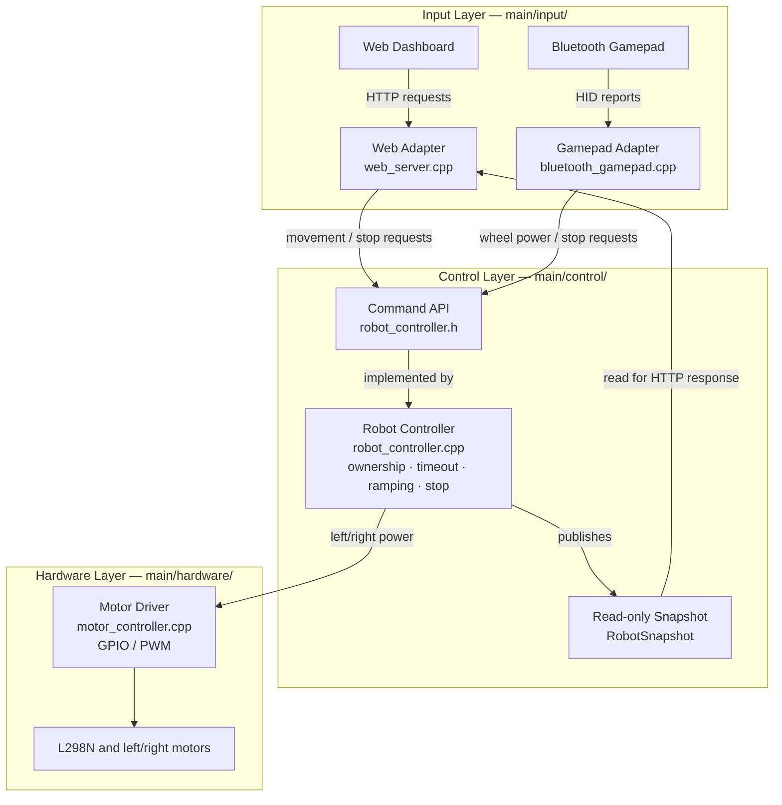

# Hierarchical Layered Architecture — Kylio RobotCar

## 1. Introduction

**Hierarchical Layered Architecture** chia module thành các layer có trách nhiệm
rõ ràng. Layer nhận yêu cầu chỉ gọi API của layer điều phối; layer điều phối quyết
định chế độ, an toàn và mục tiêu chuyển động; layer phần cứng thực hiện GPIO/PWM
và đọc cảm biến khi được bổ sung. Dữ liệu chuyển động trả về đi qua
**Read-only Snapshot** của controller.
Nhờ vậy, thêm một giao diện hoặc chế độ lái không tạo thêm đường điều khiển motor
riêng và không buộc layer nhận yêu cầu biết chi tiết của board này.

Tài liệu này là quy ước cho `main/`.

## 2. Architecture Diagram



**Control Layer** là layer điều phối ở giữa: nó nhận yêu cầu từ Input Layer,
quyết định xe có được chạy hay phải dừng, rồi gửi công suất xuống Hardware Layer.
Mọi yêu cầu chuyển động đi qua `robot_controller` trước khi đến motor.
`wifi_manager` cung cấp kết nối mạng; `telegram_client` hiện chỉ gửi thông báo
khởi động, không tham gia đường điều khiển chuyển động.

## 3. Source Structure

Đây là **cấu trúc source hiện tại**. Mỗi layer trong sơ đồ ở mục 2 có một folder
riêng; các file vẫn thuộc cùng ESP-IDF component `main`.

```text
main/
├── main.cpp                    # Điểm khởi động, khởi tạo các module
├── CMakeLists.txt
├── idf_component.yml
├── input/                      # Layer nhận yêu cầu
│   ├── web_server.cpp          # HTTP: nhận lệnh, trả trạng thái
│   ├── web_server.h
│   ├── web_page.h              # Giao diện web
│   ├── bluetooth_gamepad.cpp   # HID: kết nối, giải mã tay cầm
│   ├── bluetooth_gamepad.h
│   ├── esp_hid_gap.c           # Hỗ trợ Bluetooth HID
│   └── esp_hid_gap.h
├── control/                    # Layer điều phối
│   ├── robot_controller.cpp    # Quyền điều khiển, timeout, dừng, snapshot
│   └── robot_controller.h      # API công khai: Command Interface và Snapshot
├── hardware/                   # Layer phần cứng
│   ├── motor_controller.cpp    # GPIO/PWM cho L298N và hai bên motor
│   └── motor_controller.h
├── services/                   # Dịch vụ hỗ trợ, không điều khiển motor
│   ├── wifi_manager.cpp
│   ├── wifi_manager.h
│   ├── telegram_client.cpp
│   └── telegram_client.h
└── config/                     # Cấu hình dùng chung
    ├── app_config.h
    └── secrets.example.h       # Mẫu cho secrets.local.h trên máy phát triển
```

### Quyền sở hữu của từng layer

| Folder | Nhận đầu vào | Chịu trách nhiệm | Cung cấp ra ngoài |
| --- | --- | --- | --- |
| `input/` | HTTP, thao tác web, HID report | Kiểm tra và chuyển đầu vào thành yêu cầu chuyển động; quản lý kết nối gamepad | Gọi API của `control/`; trả phản hồi cho người dùng |
| `control/` | Yêu cầu từ `input/` | Chọn nguồn lệnh đang có quyền điều khiển, xử lý hold/timeout, tăng giảm công suất và dừng | Công suất trái/phải cho `hardware/`; `RobotSnapshot` chỉ đọc cho `input/` |
| `hardware/` | Công suất trái/phải từ `control/` | Điều khiển chiều quay, GPIO và PWM của L298N | Trạng thái phần cứng nếu sau này cần đọc |
| `services/` | Sự kiện Wi-Fi, cấu hình Telegram | Kết nối mạng và gửi thông báo khởi động | Trạng thái kết nối; không phát lệnh chuyển động |
| `config/` | Giá trị cấu hình dự án | Tập trung chân GPIO, chu kỳ controller, timeout và thông tin kết nối | Hằng số cấu hình cho các module |

### Quy tắc phụ thuộc

- Lệnh chuyển động chỉ đi theo chiều **`input/` → `control/` → `hardware/`**.
  `input/` không gọi `motor_controller` hoặc API GPIO/PWM trực tiếp.
- `control/` sở hữu trạng thái chuyển động và quy tắc an toàn. `hardware/` chỉ
  thực hiện công suất được giao, không biết lệnh đến từ web hay gamepad.
- Trạng thái chuyển động đi ngược lên bằng `RobotSnapshot` của `control/`.
  Trạng thái Wi-Fi và Bluetooth vẫn do module tương ứng cung cấp; `web_server`
  tổng hợp chúng khi trả phản hồi HTTP.
- Quét, kết nối và ngắt gamepad là thao tác quản lý thiết bị. `web_server` có
  thể gọi API này của `bluetooth_gamepad`, nhưng không dùng nó để ghi motor.
- `main.cpp` chỉ khởi tạo và nối các module. Ngoại lệ cần thiết lúc khởi động:
  gọi `motor_controller_init()` để đưa các chân điều khiển về LOW trước khi
  bắt đầu task nhận lệnh.

`MotorMotion` nằm trong `control/robot_controller.h`, vì đây là kiểu lệnh công
khai cho `input/`. `hardware/motor_controller.h` chỉ cung cấp API công suất
motor. Chưa có cảm biến trong source hiện tại; nếu bổ sung, driver cảm biến nằm
trong `hardware/`, còn quyết định dựa trên số đo nằm trong `control/`.

## 4. Command Interface

**Thuộc layer:** `control/`. Đây là API công khai tại ranh giới
`input/` → `control/`; trong source hiện tại, API nằm ở `robot_controller.h`.

**Nhiệm vụ:** Định nghĩa cách gửi yêu cầu di chuyển/dừng và đọc `RobotSnapshot`.
`robot_controller.cpp` nhận yêu cầu, quyết định quyền điều khiển và an toàn,
rồi gửi công suất xuống `hardware/`.

## 5. Control Flow

1. `main.cpp` khởi tạo motor, controller và các adapter.
2. Web hoặc gamepad chuyển thao tác thành lệnh và gửi qua Command Interface của
   `control/`.
3. `robot_controller` chọn lệnh đang có hiệu lực và gửi công suất trái/phải cho
   `motor_controller` để điều khiển GPIO/PWM.
4. Web đọc `RobotSnapshot` từ controller để hiển thị trạng thái chuyển động.
